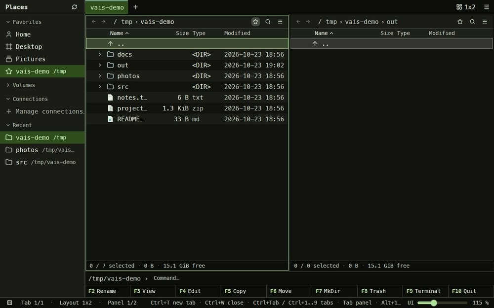

# VAIS Commander

VAIS stands for *vibecoded AI slop*.

Keyboard-driven file manager in the spirit of Total/Midnight Commander. Instead of two
fixed panes it shows a configurable grid of panels (1x2, 2x1, 1x3, 3x1, 2x2, 2x3, 3x2, 3x3,
1x1), and the window has tabs, each with its own grid. Built in Rust on
[gpui-kit](https://gpui-kit.com) (GPUI from Zed).



The same tour as a video: [docs/demo.mp4](docs/demo.mp4). `scripts/demo/record.sh` records it
again in a nested niri compositor.

Status: navigation, marking, tabs, layouts, persistence, the file operations (copy, move,
rename, batch rename, new folder, delete to trash), views, a text editor (F3 / F4),
SFTP / FTP connections and browsing archives work. Panels on local directories follow changes made by other
programs (a download finishing, a build writing files) without a manual reload.

## Install

Prebuilt binaries are on the [Releases](https://github.com/cechi/vais-commander/releases) page,
with `SHA256SUMS` next to them.

- **Linux (x86_64)**: extract `vais-commander-<version>-x86_64-linux.tar.gz` and run
  `./install.sh` inside it (binary to `~/.local/bin`, launcher entry and icon to
  `~/.local/share`). Needs a Vulkan driver and a Wayland or X11 session.
- **macOS (Apple Silicon or Intel)**: unzip, move `VAIS Commander.app` to Applications. The app
  is not signed, so the first launch needs `xattr -dr com.apple.quarantine "/Applications/VAIS Commander.app"`
  (or right-click → Open).
- **Windows (x86_64)**: unzip and run `vais-commander.exe`; put the folder wherever you like.

## Build & run

```sh
cargo run            # binary is target/debug/vais
cargo test           # unit tests (sorting, formatting, layout, marks, config, keymap)
```

Requires Rust 1.92+. Linux needs a Vulkan driver and a Wayland or X11 session;
Arch/CachyOS packages: `clang fontconfig wayland libxkbcommon libxkbcommon-x11 libxcb
libx11 openssl zstd vulkan-icd-loader` plus your GPU's Vulkan ICD.

## Releasing

1. Bump `version` in `Cargo.toml`, commit.
2. `git tag -a v0.x.y -m "VAIS Commander 0.x.y"` and `git push origin master v0.x.y`.
3. The `Release` workflow builds Linux, macOS (arm64 + x86_64) and Windows packages
   (`scripts/package.sh`), checks the tag against `Cargo.toml`, and publishes a GitHub release
   with generated notes and `SHA256SUMS`. A tag containing `-` (e.g. `v0.2.0-beta.1`) becomes a
   pre-release.

## Platforms

Linux is the developed and tested platform. macOS and Windows are supported in code
(GPUI runs on both) but untested so far:

- Shortcuts use the platform's primary modifier: `Ctrl` on Linux/Windows, `Cmd` on macOS.
  On macOS panel focus is `Cmd+Alt+arrows`, hidden files `Cmd+Shift+.`, and Finder-style
  `Cmd+Up` / `Cmd+Down` go up / open.
- Hidden files: dot-prefix on Unix, the hidden attribute (or dot-prefix) on Windows.
- Windows drive roots: `..` above `C:\` opens a "Computer" listing of mounted drives.
- Packaging (`scripts/install-desktop.sh`) is Linux-only; a macOS `.app` bundle and a Windows
  shortcut/icon are still to do.
- CI (`.github/workflows/ci.yml`) builds and tests on Ubuntu, macOS and Windows.

## Launcher entry

```sh
scripts/install-desktop.sh        # release build, ~/.local/bin link, .desktop + icon
scripts/install-desktop.sh debug  # same, but linking the debug binary
```

Installs for the current user only (`~/.local/...`). The binary is a symlink into
`target/`, so a rebuild updates what the launcher starts.

## System file picker (Linux)

VAIS Commander can be the dialog other applications open to pick or save files. On Linux
that goes through [xdg-desktop-portal](https://flatpak.github.io/xdg-desktop-portal/): an
application asks the portal for a file chooser, the portal asks the backend named in
`portals.conf`, and `vais-commander --portal` is such a backend (interface
`org.freedesktop.impl.portal.FileChooser`, bus name `org.freedesktop.impl.portal.desktop.vais`).

```sh
scripts/install-portal.sh           # repo checkout; or ./install-portal.sh from a release archive
scripts/install-portal.sh --force   # also when portals.conf names another backend already
scripts/install-portal.sh --uninstall
```

The script installs a D-Bus service file (`~/.local/share/dbus-1/services/`, so the backend
starts on demand), the `vais.portal` description (`~/.local/share/xdg-desktop-portal/portals/`;
`--system` puts it into `/usr/share` with sudo for xdg-desktop-portal older than 1.17), sets
`org.freedesktop.impl.portal.FileChooser=vais;gtk;` under `[preferred]` in
`~/.config/xdg-desktop-portal/portals.conf` and restarts the portal. The backend reads the
normal config (theme, font, UI scale, favorites, system places) and never writes it; it stays
resident for ten minutes after its last window and is started again by D-Bus when needed.

Which applications ask the portal is up to them:

- Firefox: `widget.use-xdg-desktop-portal.file-picker` = `1` in `about:config` (the default
  `2` means "only when sandboxed or `GTK_USE_PORTAL=1`").
- GTK 3/4 applications, Chromium and Electron apps: start them with `GTK_USE_PORTAL=1` (per
  application; setting it globally makes GTK's own portal backends loop).
- Qt applications: `QT_QPA_PLATFORMTHEME=xdgdesktopportal`.
- Flatpak and Snap applications use the portal anyway.

The picker is a Places sidebar plus one panel with the usual keys: `Enter` (or a double
click) chooses a file or enters a directory, `Space` / `Insert` mark several files when the
caller allows it, `Ctrl+Enter` or the button accepts the marks, the entry under the cursor or,
when choosing a folder, the current directory, `Ctrl+H` shows hidden files, `Esc` cancels.
Saving shows a name field (prefilled, the extension kept) and asks before replacing a file. The
caller's filters are a dropdown in the bottom bar; glob patterns match case-insensitively, MIME
types through the desktop's MIME database. Limits: only local paths can be returned (no
connections or archives), the window is not modal to the calling application (Wayland has no
way to parent it), and the caller's extra choice boxes are answered with their defaults.

## Keys

Keys below are for Linux/Windows; on macOS read `Ctrl` as `Cmd` (see Platforms).

| Keys | Action |
|---|---|
| `Ctrl+T` / `Ctrl+W` | New tab (copy of the current one) / close tab |
| `Ctrl+Tab` / `Ctrl+Shift+Tab`, `Ctrl+PgDn` / `Ctrl+PgUp` | Next / previous tab |
| `Ctrl+1 … Ctrl+9` | Activate tab |
| `Tab` / `Shift+Tab` | Next / previous panel (reading order, wraps) |
| `Ctrl+↑ ↓ ← →` | Move focus to the neighbouring panel |
| `Alt+1 … Alt+9` | Layout 1x2, 2x1, 1x3, 3x1, 2x2, 2x3, 3x2, 3x3, 1x1 |
| `↑ ↓ PgUp PgDn Home End` | Move cursor |
| `Shift` + the above | Move cursor and mark the range |
| `Insert` / `Space` | Toggle mark (Insert also moves down; on a directory the size is counted and shown) |
| `Ctrl+A` / `Ctrl+Shift+A` | Mark all / invert marks |
| `Ctrl+M` / `Ctrl+U` | Mark / unmark entries matching a pattern (`*.ext` of the current file is offered) |
| `Esc` | Cancel path edit, dismiss error, or clear marks |
| `Enter` | Enter directory (`..` goes up) |
| `→` / `←` | Expand the directory under the cursor inline (tree view) / collapse it, or jump to the parent row |
| `Backspace` | Parent directory |
| `Alt+←` / `Alt+→` | Back / forward in the panel's history (also the arrows before the path) |
| `Ctrl+L` | Edit the path (`~` expands); `Enter` to go, `Esc` to cancel. The path bar is also a breadcrumb: click a segment to go there, click the space after it to edit |
| `Ctrl+F` | Filter bar (also the magnifier after the path): type to filter the listing live, case-insensitive; `*` / `?` turn the query into a glob (`*.png`). "Subfolders" (`Ctrl+Shift+F`) searches the whole subtree in the background (results show their relative path, up to 5000); "Contents" (`Ctrl+Shift+G`) looks for the text inside files instead (case-insensitive, text files up to 8 MiB, also on connections and in archives). `Enter` returns to the list with the filter kept, `Esc` closes it |
| `Ctrl+H` | Toggle hidden files |
| `Ctrl+R` | Reload (local panels also reload on their own when the directory changes) |
| `Shift+Enter` | Open the file with its default application (Enter does too, except for archives) |
| typing | Quick search: filters the listing by what is typed (Esc clears) |
| `Ctrl+Shift+P` | Command palette: every action by name, with its key |
| `Ctrl+D` | Add the current directory to the sidebar's Favorites, or remove it (the star next to the path does the same) |
| `Ctrl+E` | Focus the command line |
| `Ctrl+Shift+B` / `` Ctrl+` `` / `Ctrl+Shift+N` | Agents panel: toggle / focus it or go back to the files / new session |
| `Ctrl+Enter` / `Ctrl+Shift+Enter` | Put the name / full path of the entry under the cursor on the command line |
| `Ctrl+F1` / `Ctrl+F2` / `Ctrl+F3` | View: brief (names in columns) / full (list with columns) / thumbnails; also the view button after the path and the panel's context menu. See Views |
| `Ctrl+Shift+F3` / `F4` / `F5` / `F6` | Sort by name / type / modified / size; the same key again flips the direction. Clicking a column header does the same, the panel's context menu lists the keys too |
| `Ctrl+C` / `Ctrl+X` / `Ctrl+V` | Copy / cut the marked (or cursor) entries, paste them into the active panel's directory (also in the context menus). Cut entries are dimmed until pasted; the status bar shows what is waiting. With no files waiting, `Ctrl+V` saves an image from the system clipboard (a screenshot, a copied picture) into the directory, asking for the file name first |
| `Ctrl+Shift+C` | Copy the selected paths (or the directory) to the clipboard |
| `F3` / `F4` | View / edit the file under the cursor in an editor tab (see Editor) |
| `F9` | Open a terminal in the panel's directory (`$TERMINAL`, else the first of ghostty, alacritty, kitty, foot, …) |
| `F5` / `F6` | Copy / move the marked (or cursor) entries. A chooser opens with the destination path on top and the other panels of the grid below it: `↑` / `↓` pick a panel (the path follows and the panel lights up in the grid), or type any path; `Enter` or a click confirms, `Esc` cancels |
| `F2` / `Shift+F6` | Rename the entry under the cursor (the name without its extension is preselected). With several entries marked, a batch rename form opens in its own tab: masks (`[N]` name, `[E]` extension, `[C]` counter with start / step / digits), find & replace (plain or regex with `$1` groups, optional ignore case), case change, and a live preview that flags empty, duplicate or existing names. `Ctrl+Enter` renames, `Esc` closes |
| `F7` | New folder |
| `F8` / `Delete` | Move to trash; `Shift+F8` / `Shift+Delete` deletes permanently |
| `Esc` | Cancel the latest running operation (when there is nothing else to clear) |
| `Ctrl+J` | Show / hide the operations panel |
| `Ctrl+B` | Show / hide the places sidebar (also the toggle at the left of the status bar) |
| `Ctrl+K` | Connection manager tab (see Connections) |
| `Ctrl+,` | Settings tab: theme, UI scale, file icons (desktop icon theme on Linux, shell icons on Windows, or generic; folders always use the built-in icon), sidebar, command line, function key bar, drag & drop behaviour, config and themes folders (also in the ☰ menu at the right of the tab bar, which lists the other app-level commands too) |
| `Ctrl+Shift+T` | Choose a theme (built-in or from the themes directory); type to filter the list |
| `Ctrl+Shift+D` | Toggle light / dark |
| `Ctrl+=` / `Ctrl+-` / `Ctrl+0` | UI scale up / down / reset (also the slider in the status bar and Ctrl+mouse wheel) |
| `Ctrl+Q` / `F10` | Quit |

Mouse: click selects a row and focuses its panel, double-click opens, `Ctrl+click` toggles a
mark, `Shift+click` marks the range from the cursor, dragging from an unmarked row or from the
empty area draws a selection rectangle (plain drag replaces the marks, `Ctrl`/`Shift` drag adds
to them, the list scrolls when you drag past its edge, a plain click in the empty area clears
the marks), dragging the dividers resizes the grid,
tabs are clickable with a close button and a `+`, and can be reordered by dragging. Drag marked entries (or a single row) onto
a directory row, `..`, or the empty area of any panel to drop them there; `drop_action` in
the config decides what happens: `ask` (default, a small Move / Copy menu at the drop point), `move` or `copy`. The
function key bar above the status bar has a button per F-key; hold Shift to see the
Shift variants (F6 Rename, F8 permanent delete). Settings and the ☰ menu hide it (the keys
keep working), and the command line the same way. Directories have a chevron that expands
them inline as a tree (any depth); marks and the cursor follow paths across reloads, and
operations work on nested entries. Right-click on an entry opens a context
menu (open, copy/move, rename, marks, trash/delete, copy path, new folder, terminal);
right-click on empty panel space offers the panel actions (new folder, terminal, marks,
path, hidden files, reload, up, back).

File operations act on the marked entries of the active panel (or the entry under the
cursor), target the previously focused panel and ask before overwriting (overwrite or
skip). Each operation runs on its own background thread and gets a row in the
**operations panel** at the bottom of the window (independent of tabs, opens
automatically, resizable): progress bar, bytes and items, current file, a speed
sparkline, elapsed time, status, and a cancel / remove button. The status bar shows the
number of running operations and their combined speed. Enter on a file opens it with the
system's default application.

## Configuration

Saved automatically (debounced and on quit) to `~/.config/vais-commander/config.toml`
(version 2): theme, UI scale, window bounds, the active tab and one `[[tabs]]` entry per tab with
its layout, divider positions as fractions and each panel's path, hidden-files toggle and
sort. A version 1 file (single layout) is migrated into one tab. A missing or invalid file
falls back to defaults with a logged warning (`RUST_LOG=warn`).

## Views

Each panel has its own view, saved with the tab:

- **Full** (`Ctrl+F2`): one entry per row with columns. Right-click the column header to
  choose the columns: Size, Type, Modified, Created, Permissions and Owner (the last two
  on Unix). Clicking a sortable header sorts by it. Directories expand inline here.
- **Brief** (`Ctrl+F1`): names only, as many columns as fit. `←` / `→` move the cursor
  sideways, `↑` / `↓` by a line; marking, drag & drop and the rubber band work as usual.
- **Thumbnails** (`Ctrl+F3`): a grid with image previews (png, jpg, gif, webp, bmp,
  tiff, ico, qoi, svg) and large icons for everything else. Previews are generated in the
  background and cached under the user cache directory (`~/.cache/vais-commander/thumbs`).

## Editor

`F3` opens the file under the cursor read-only, `F4` editable, both in a tab next to the
current one using gpui-kit's code editor: line numbers, search (`Ctrl+F`), replace
(`Ctrl+H`), undo and syntax highlighting by extension. Viewing and editing are the same
tab; the Read-only / Editable button (or `Ctrl+Shift+E`) switches between them, so a
look at a file never changes it by accident. `Ctrl+S` saves (CRLF line endings are kept),
Reload re-reads the file, and closing a tab with unsaved changes asks whether to save.
Files over 8 MiB, binary files and files that are not valid UTF-8 are not edited: the
first two open with the default application, the last stays read-only.

## Connections (SFTP, FTP)

Remote directories are browsed like local ones. Saved connections live in the config as
`[[connections]]` (id, name, host, port, user, directory, authentication, optional key
file; never a password) and appear in the sidebar's **Connections** group; clicking one
connects and opens its directory in the active panel. `Ctrl+K`, the ☰ menu or "Manage
connections…" in the sidebar opens the connection manager tab (list + form, Connect,
Disconnect, Remove). Authentication tries the SSH agent and the usual `~/.ssh` keys, a
chosen key file, or a password; a password is asked for with a masked prompt and, for
connections set to password authentication, stored in the system keyring (Secret
Service / Keychain / Credential Manager). The host key is not verified yet. Hosts from
`~/.ssh/config` (with `Include`) work too: a host field holding an alias gets its
`HostName`, `Port`, `User` and `IdentityFile` from there where the connection leaves
them empty or at the default, and the "ssh config" button in the manager lists the
aliases to start a connection from.

A remote location is written as `id:/path` (`nas:/srv/www`) and can be typed into the
path bar (`Ctrl+L`); panels on a connection are restored at startup and connect when
first shown. Copy and move work in every direction (upload, download, remote to remote,
even between connections) through streamed transfers with the usual progress; renaming,
new folders and deleting work remotely (no trash: deletions there are permanent). The
editor reads and writes remote files through the connection, thumbnails are generated
from them, and "open with the default app" downloads a copy into the cache directory
first; only the terminal needs a local directory. Protocols: SFTP (libssh2) and plain
FTP (passive mode; an empty user means anonymous, otherwise a password which is kept in
the keyring; each transfer opens its own data session). FTPS is not supported yet.

## Command line

Under the panels sits a shell prompt for the active panel's directory (hide it in
Settings or the ☰ menu). `Ctrl+E` focuses it, `Ctrl+Enter` appends the name under the cursor,
`Ctrl+Shift+Enter` its full path, `Up` / `Down` walk the history (kept in the config),
`Esc` goes back to the panel. Enter runs the line through `$SHELL -c` (`cmd /C` on
Windows) in that directory: a command with output opens it in a read-only tab, one without
just reports its exit code. `cd dir` moves the panel instead. Interactive programs need a
real terminal (F9).

## Agents

`Ctrl+Shift+B` (or the button at the right end of the status bar) opens the **Agents**
panel at the right edge: terminals in tabs, each running a coding agent or a plain shell.
The panel lists what is installed (`claude`, `opencode`, `codex`, `gemini` found on `PATH`,
plus your shell); `+` or `Ctrl+Shift+N` starts a session in the active panel's directory.
`` Ctrl+` `` moves the focus into the panel (opening it) and back to the files.

The terminal is a real one (alacritty's emulator core): colours, full-screen programs,
mouse selection, `Ctrl+Shift+C` / `Ctrl+Shift+V` copy and paste (bracketed when the program
asks), `Shift+PgUp` / `Shift+PgDn` scroll the history, the wheel too. Keys the program may
want (F-keys, `Ctrl+T`, `Ctrl+W`, `Ctrl+Q`…) go to it, not to the app; the global ones
(`Ctrl+Shift+P`, zoom, the panel toggles) still work. When the program exits, `Enter` or the
Restart button starts it again.

Every session gets the app's **MCP server**: `vais-commander --mcp` is registered for that
run only (Claude Code through `--mcp-config` and `--allowedTools mcp__vais__*`, OpenCode
through `OPENCODE_CONFIG_CONTENT`, Codex through `-c mcp_servers.vais.*`, Gemini CLI through
a settings file named in `GEMINI_CLI_SYSTEM_SETTINGS_PATH`; the Codex and Gemini forms are
untested here). The server forwards tool calls to the running app over a socket under
`$XDG_RUNTIME_DIR/vais-commander/` (loopback TCP with a token on Windows), so the agent can do
what you would do by hand:

| Tool | What it does |
|---|---|
| `get_state` | Tabs, layouts, panels, their directories, cursor and marked entries |
| `list_dir`, `search` | Read a directory; find entries by name or by text inside files (connections and archives included) |
| `navigate`, `set_layout`, `new_tab`, `activate_tab`, `close_tab` | Panels and tabs, like the keys |
| `select` | Mark entries by names or a pattern, place the cursor |
| `copy`, `move` | F5 / F6; existing files bring up the usual Overwrite / Skip / Cancel dialog, and the call waits for the operation |
| `rename`, `mkdir` | Never overwrite |
| `delete` | To the trash (or permanently); **you confirm it in a dialog** that names the agent, and `Esc` tells the agent it was cancelled |
| `open_file`, `add_favorite`, `save_layout`, `set_tab_title`, `set_tab_color` | The rest of the UI |

Writes into archives are refused. An agent started outside the app can use the same server:
`claude mcp add vais -- vais-commander --mcp` (it talks to the newest running instance).

## Archives

Enter on a zip (also jar, apk, whl…), 7z, tar, tar.gz / tgz, tar.bz2, tar.xz or tar.zst
file opens it like a directory: browse, expand, copy files out (F5, Ctrl+C, drag), view
them with F3 and show thumbnails. The path reads `archive.zip!/dir/file`; Backspace from
the root goes back to the archive file. Archives are read-only: delete, rename, new
folder and copying into one are refused. Zip entries are extracted on first use, a tar
or a 7z is unpacked when opened (7z: LZMA, LZMA2, PPMd, BZip2, Deflate and Zstandard;
encrypted ones are refused with a message); all of them go under
`~/.cache/vais-commander/archives` (cleaned of entries unused for a week). Archives on a connection are fetched first. `Shift+Enter`
hands the archive to the default application instead.

Right-click an archive and choose **Extract…** to unpack it: the chooser offers every
panel of the layout twice, its directory and a folder named after the archive in it
(`site.tar.gz` → `site`), with the archive's own panel and folder preselected; the panel a
row points at is highlighted, and any typed path works too (missing folders are created).
The contents of the archive's root are copied there as one operation in the operations
panel, and files that exist already are asked about like with any copy.

## Sidebar

`Ctrl+B` or the toggle at the left end of the status bar opens a sidebar with system places:
home and the standard user folders (XDG user dirs, else `~/Desktop` & co.), the root and
mounted volumes (`/mnt`, `/media`, `/run/media`, `/home`, macOS `/Volumes`, Windows drives).
The Favorites group also holds your own entries of two kinds: directories (the star next
to a panel's path, or `Ctrl+D`, toggles the current one) and whole layouts (right-click a
tab, "Add layout to favorites…", give it a name: the tab's grid and panel paths are saved
and open as a new tab named after the layout when clicked). Right-click a favorite to
rename it (a directory gets a fixed name instead of its own, a layout a new name), to tag
it with a colour (the same presets and custom hex as a tab, drawn as a thick left border;
a layout's colour is also the colour of the tabs opened from it), or to remove it.
"System places in Favorites" in Settings (`system_places` in the config) turns
the home and user folders off; the group then holds only your own favorites and is not
shown at all while there are none. "Rename tab…" in the same tab menu gives a tab a fixed title instead of the
active panel's directory name (saved with the tab; empty goes back to the directory), and
"Tab color…" tags the tab with one of nine preset colours or any `#rrggbb`: a stripe
along the top of the tab, and a thick left border on the layout once saved to Favorites.
Below them a **Recent** group lists the last 10 directories the focused panel showed
(newest first, remembered across restarts). Clicking a place navigates the active panel;
the place matching the panel's directory is highlighted. Each group folds on a click of its header, and the folded ones are remembered across restarts. The list scrolls (with a scrollbar) when it is taller than the window. The sidebar is resizable, its state is saved, and the tab bar, panels and
function key bar shift right while it is open; the status bar keeps the full width.

## Themes

Four themes are built in: the kit's Default Light / Dark and **Cechi Light / Dark**, a
Material-ish pair generated from a [DankMaterialShell](https://github.com/AvengeMedia/DankMaterialShell)
palette (`scripts/cechi-theme.py` regenerates `assets/themes/cechi.json`; the Cechi themes
also carry syntax colours for the editor). Any other [gpui-kit theme file](https://gpui-kit.com/component/theme)
(JSON, a `themes` array with `name`, `mode`, `colors`, optional `highlight`, fonts and radius)
placed in `~/.config/vais-commander/themes/` is loaded and watched, so edits apply while
the app runs. `Ctrl+Shift+T` opens the picker; the choice is stored as `theme = "<name>"`
in the config (`light`, `dark` and `system` select the kit defaults). Fonts are personal
rather than part of a theme: the Font row in Settings (any installed family, or "Theme
default") is stored as `font_family = "MesloLGS Nerd Font"` in the config and applies
that family to the UI and the editor whatever the theme.

## Layout of the code

```
src/main.rs        bootstrap: config, key bindings, theme, window
src/app.rs         Workspace: tabs, tab bar, theme, persistence
src/tabs.rs        Tab + TabContent enum (Grid today; settings etc. later)
src/grid_view.rs   GridView: 9 panels, grid layout, focus between panels
src/layout/        Layout {rows, cols} + grid rendering with nested resizable groups
src/panel/         FilePanel entity (rendering, actions), PanelState (cursor, marks), view.rs (view modes, columns)
src/vfs/           Location (local path, connection + path, or path in an archive) and the Backend trait; local.rs is the disk, sftp.rs libssh2, ftp.rs suppaftp, archive.rs zip/tar/7z
src/connections.rs saved connections, the backend registry, the connection manager (connect on the background executor, keyring)
src/connections_view.rs  the connection manager tab
src/ssh_config.rs  reader for ~/.ssh/config (aliases, HostName, Port, User, IdentityFile, Include)
src/fs/            directory listing through the backend, natural sort, search, size/date formatting
src/ops/           copy / move / delete with byte-level progress and cancel; manager.rs runs them
src/ops_panel.rs   the operations panel (rows with progress, speed sparkline, cancel)
src/palette.rs     command-center style dialog body: value input + rows (F5/F6, F2, F7) or a choice list (F8, conflicts, themes)
src/keymap.rs      actions and default bindings
src/clipboard.rs   the file clipboard behind Ctrl+C / X / V
src/command_line.rs  the shell prompt under the panels (history, Ctrl+Enter insertion)
src/agents/        the Agents panel: sessions in tabs, detection of installed CLIs, per-CLI launch with the MCP server registered
src/terminal/      the embedded terminal: alacritty_terminal session (pty.rs), grid painting (element.rs), key encoding (keys.rs), colours
src/bridge/        the socket other processes drive the app through, and the tool catalogue; src/app/tools.rs carries the tools out
src/mcp.rs         `vais-commander --mcp`: the MCP server on stdio, forwarding to the bridge
src/portal/        `vais-commander --portal`: the xdg-desktop-portal file chooser backend (ashpd service, picker window, URIs and filters)
src/rename/        batch rename: rules and preview (mod.rs), the form tab (view.rs)
src/settings_view.rs  the settings tab
src/editor_view.rs  the file editor tab (view / edit)
src/icons/         file icons from the desktop: freedesktop theme lookup (mod.rs), Windows shell icons (shell.rs)
src/config.rs      TOML config
src/theme.rs       theme directory watching and applying a theme by name
src/sidebar.rs     places sidebar (user folders, volumes)
src/watch.rs       directory watching (notify): panels on local directories reload when they change
```
